  

# 🚚 Awesome Distributed Endpoint Fleet Management 📡

**A curated, production-grade index of Enterprise SaaS Platforms & Open-Source Projects for Telematics, IoT Connected Vehicles, and Distributed Asset Operations.**

  
  
  
  
  
  
  

**Keywords:** `fleet-management` • `vehicle-telematics` • `gps-tracking` • `distributed-endpoints` • `iot-fleet` • `eld-compliance` • `obd-ii` • `can-bus` • `route-optimization` • `autonomous-amr`

*Last updated: March 2026*

---

## 📖 Overview

This repository tracks notable **SaaS platforms** and **open-source software** powering **Distributed Endpoint Fleet Management**. Whether orchestrating commercial logistics, long-haul trucking, public transport, field service vans, or autonomous robotics, these platforms deliver:
- 📍 **Real-Time GPS & Asset Tracking**: Protocol-agnostic telematics, breadcrumb trails, and Haversine geofencing.
- 📹 **AI Video Safety Telematics**: Dual-facing dashcams with in-cab computer vision alerting for distracted driving.
- ⏱️ **Regulatory & Compliance Automation**: FMCSA-compliant ELD (Electronic Logging Devices) and HOS (Hours of Service).
- 🚗 **Vehicle Diagnostics & Maintenance**: OBD-II and CAN bus DTC fault code telemetry, preventative service workflows, and DVIR mobile walkaround inspections.
- 🗺️ **Algorithmic Route Optimization**: Multi-stop VRP (Vehicle Routing Problem) solvers factoring capacity, time windows, and live road conditions.

---

## 📑 Table of Contents
- [📊 Sector Overview & Market Dynamics](#-sector-overview--market-dynamics)
- [🏢 SaaS / Hosted Platforms](#-saas--hosted-platforms)
- [💻 Open-Source GitHub Projects](#-open-source-github-projects)
- [🤝 How to Contribute](#-how-to-contribute)
- [⭐ Star History](#-star-history)
- [💖 Support](#-support)
- [⚠️ Disclaimer](#️-disclaimer)

---

## 📊 Sector Overview & Market Dynamics

The global fleet management market is estimated at approximately **$30B to $43.5B in 2026** (projected to surpass $70B+ by the early 2030s at an annual compound growth rate of 10%–15%), propelled by rapid connected IoT adoption, mandatory electronic logging/compliance frameworks, and mixed-fleet electric vehicle (EV) transitions. 

The market exhibits **moderate fragmentation**: while top-tier telematics and telecom enterprises (such as Verizon Connect, Samsara, and Geotab) command substantial consolidated footprints (holding ~40% of the enterprise market), the remaining ecosystem is distributed among hundreds of specialized regional, vertical, and niche software providers rather than operating as a pure "winner-take-all" domain.

---

## 🏢 SaaS / Hosted Platforms

| Product | Company Size (Valuation / Revenue) | Description | Starting Pricing | Free Tier / Trial Limits |
|---|---|---|---|---|
| **[Verizon Connect](https://www.verizonconnect.com/)** | **~$190B – $195B Market Cap** (Parent: Verizon Communications NYSE: VZ; Connect division ~$600M+ revenue) | Enterprise telematics and workforce management division offering GPS fleet tracking, automated route compliance, ELD compliance, and dispatch management for large-scale fleets. | **$20.00/vehicle/month** (Core fleet tier; typical bundles range $25–$40/vehicle/month; hardware ~$150–$300 separate) | **No free tier**; 30-day proof-of-concept / guided demo available upon sales qualification (no automated self-service free trial) |
| **[Samsara](https://www.samsara.com/)** | **~$24B – $25B Market Cap** (NYSE: IOT; ~$1.84B TTM revenue / $1B+ ARR) | Connected physical operations cloud combining GPS telematics, AI dash cams, real-time safety coaching, driver workflows, and ELD compliance. | **$27.00/vehicle/month** (Vehicle Tracking tier; Fleet Management starts at $33/vehicle/month; Complete Platform at $50/vehicle/month) | **30-day free trial** for new fleet customers (hardware demo kit included for qualifying commercial fleets; no permanent free tier) |
| **[Motive](https://gomotive.com/)** | **~$2.85B Valuation / $1.3B Growth Financing** (~$600M+ ARR) | AI-powered operations platform providing automated ELD compliance, dual-facing AI dash cameras, driver safety scoring, and fuel card management. | **$25.00/vehicle/month** (Starter ELD tracking tier; Complete Fleet Platform ~$35/vehicle/month; hardware starting at ~$150) | **14-day free trial** available for fleet tracking software evaluation upon request; no permanent free tier |
| **[Fleetio](https://www.fleetio.com/)** | **~$1.5B Valuation** (Series D backed by Goldman Sachs; ~$40M – $60M ARR) | Maintenance-first fleet operations software handling work orders, fuel card syncing, mobile DVIR inspections, and parts inventory without requiring proprietary OBD hardware. | **$4.00/vehicle/month** (Essential tier billed annually; Professional tier at $7.00/vehicle/month; Premium at $10.00/vehicle/month) | **14-day free trial** (full access to features, no credit card required); no permanent free tier |
| **[Geotab](https://www.geotab.com/)** | **~$1B+ Valuation** (Bootstrapped / employee-owned unicorn; ~$500M – $1B annual revenue; 4M+ connected vehicles) | Open telematics ecosystem with extensive OEM direct integrations, rich CAN bus diagnostic extraction, and 200+ partner marketplace add-ons. | **$10.00/vehicle/month** (Base telematics tier via resellers, typically $10–$18/vehicle/month; GO device hardware ~$100) | **No free tier**; 30-day pilot / proof-of-concept trial program available through certified Geotab resellers |
| **[Teletrac Navman](https://www.teletracnavman.com/)** | **~$220M Transaction Valuation** (Acquired by Respida Capital; ~$250M – $500M annual revenue) | Enterprise telematics and fleet tracking platform tailored for transportation compliance, GPS asset tracking, and heavy equipment monitoring. | **$25.00/vehicle/month** (Standard GPS tracking tier; comprehensive compliance/video packages run $35–$45+/vehicle/month; 36-month standard agreement) | **No free tier**; 14-day to 30-day proof-of-concept pilot available for qualified enterprise fleets via sales consultation |
| **[GPS Insight](https://www.gpsinsight.com/)** | **Private / Accel-KKR Backed** (~$35M – $60M annual revenue) | Field service and fleet telematics platform featuring real-time vehicle tracking, smart dash cams, driver safety scoring, and dispatch workflows. | **$14.95/vehicle/month** (Standard tracking tier; bundled smart video and field service packages scale up based on fleet size) | **No free tier**; 14-day scheduled live pilot / guided trial available upon sales consultation |

---

## 💻 Open-Source GitHub Projects

| Project | Stars_Badge | Description |
|---|---|---|
| **[Traccar](https://github.com/traccar/traccar)** |  | **The most widely deployed open-source GPS tracking server.** Java backend supporting 200+ device telematics protocols, customizable web UI, REST API, geofencing, and notifications. Runs self-hosted or containerized with zero per-vehicle licensing costs. |
| **[OpenRemote](https://github.com/openremote/openremote)** |  | **Open-source IoT device management and telematics platform.** Includes dedicated fleet management capabilities, native Teltonika tracker integration, automated protocol processing, geofencing rules engine, and custom multi-tenant tracking dashboards. |
| **[VROOM](https://github.com/VROOM-Project/vroom)** |  | **High-performance vehicle routing optimization engine.** Solves complex vehicle routing problems (VRP, CVRP, VRPTW, and pickup-and-delivery) in real-time, integrating seamlessly with OpenStreetMap, OSRM, Valhalla, and custom fleet dispatchers. |
| **[OwnTracks Recorder](https://github.com/owntracks/recorder)** |  | **Lightweight private location tracking and geofencing server.** Stores and visualizes real-time and historical location telemetry published by mobile devices and GPS trackers via MQTT or HTTP with full data sovereignty. |
| **[GPS-Tracker](https://github.com/eusonlito/GPS-Tracker)** |  | **Full-stack self-hosted GPS tracking platform.** Built with Laravel and MySQL, supporting leading hardware trackers (Sinotrack, Coban, Teltonika, Concox, OsmAnd, Queclink) with live mapping and device administration. |
| **[free_fleet](https://github.com/open-rmf/free_fleet)** |  | **Open-RMF fleet management and adapter framework.** Orchestrates and coordinates fleets of autonomous mobile robots (AMRs) and automated vehicles, managing task dispatch, traffic deconfliction, and live status reporting. |
| **[jt-vehicle-platform](https://github.com/liuxiaoyan199701-coder/jt-vehicle-platform)** |  | **Telematics & video surveillance gateway.** Implements standard ministerial transport protocols (JT/T 808 vehicle GPS positioning and JT/T 1078 live video streaming) with a Spring Boot and Netty backend. |
| **[VSD Fleet Management](https://github.com/navariltd/Fleet-Management-System)** |  | **Enterprise fleet lifecycle ERP system built on Frappe / ERPNext.** Covers cargo booking, driver and vehicle assignments, trip execution, fuel approval workflows, and maintenance ledger accounting. |
| **[sachnaror/fleet-management-system](https://github.com/sachnaror/fleet-management-system)** |  | **Python telematics and diagnostics platform.** Built with FastAPI and SQLAlchemy, integrating OBD-II/CAN bus diagnostic trouble code (DTC) decoders, real-time GPS tracking, and rule-based safety alerts. |

---

## 🤝 How to Contribute

Contributions are warmly welcomed! To help maintain the highest standard of accuracy:
1. 🍴 Fork the repository.
2. ✍️ Add or update entries in [README.md](README.md) following the existing table layout.
3. 📌 Ensure you provide: product name, official link, verified company size (valuation/revenue) or stars, explicit starting pricing, and concrete free tier/trial limits.
4. 🚀 Submit a Pull Request with a brief explanation and citations.

---

## 📈 Star History

---

## 💖 Support

Thank you for exploring and utilizing this curated guide! 🌟

If you find this repository valuable for your telematics research, engineering projects, or fleet operations, please consider supporting the project:
- ⭐ **Star** this repository on GitHub to help others discover it.
- 🍴 **Fork** and contribute new tools, libraries, and frameworks.
- 📢 **Share** it with fellow fleet managers, engineers, and IoT architects.
- ☕ **Buy me a coffee**: Support ongoing curation and maintenance via the [GitHub Sponsors Dashboard](https://github.com/sponsors/ishandutta2007).

---

## ⚠️ Disclaimer

- This is a **community-curated index** — not exhaustive and not a commercial endorsement.
- Fleet management systems process sensitive telemetry, real-time geolocation, and driver telemetry. Always enforce appropriate privacy safeguards, role-based access, and compliance standards (GDPR, FMCSA ELD, local labor tracking laws).
- Pricing, features, and company valuation data are verified against publicly available documentation and industry reports as of 2025–2026 and are subject to change by vendors.

---

  Built with ❤️ for fleet operators, telematics engineers, and distributed IoT developers worldwide.

